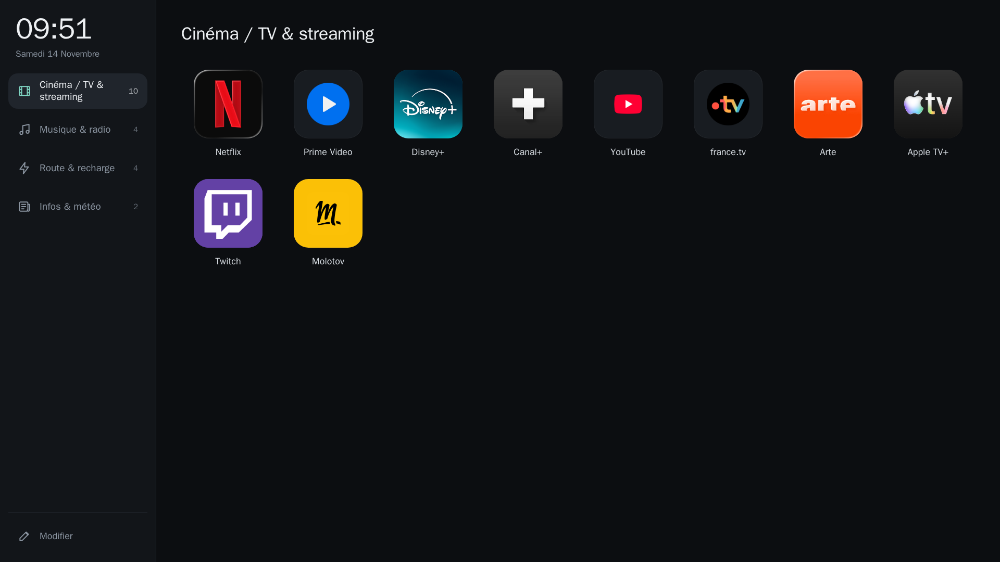
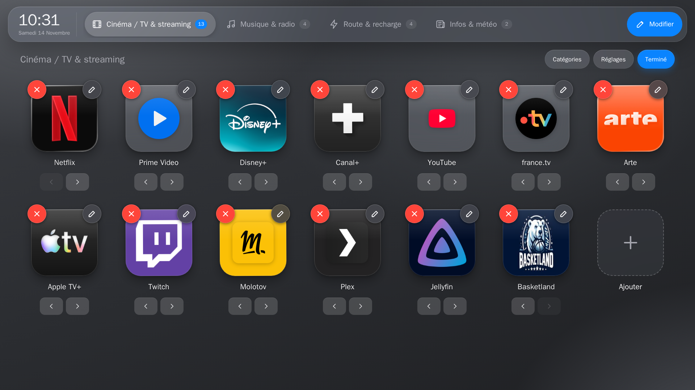
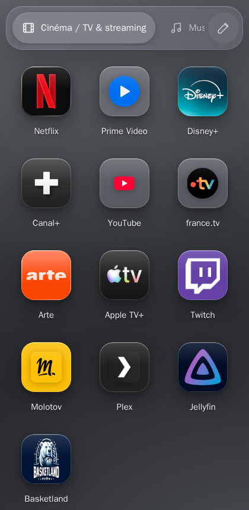

# menuxpeng

Menu de liens pour le navigateur de la XPeng G6 : grandes tuiles tactiles, catégories, logos récupérés automatiquement.



## Fonctions

- Catégories dans une colonne à gauche (Cinéma / TV & streaming, Musique & radio, Route & recharge, Infos & météo au départ). On passe de l'une à l'autre en la touchant ou en balayant la grille.
- Ajout d'un lien en tapant l'adresse : le nom et le logo sont trouvés seuls. Si le logo du site est trop petit, l'icône de l'application sur l'App Store (512 px) est utilisée. On peut aussi choisir parmi d'autres logos, en chercher un par nom ou coller l'adresse d'une image.
- Mode Modifier : renommer, supprimer, déplacer un lien, le changer de catégorie ; créer, renommer, réordonner et supprimer les catégories (21 icônes).
- Taille des logos réglable, ouverture dans le même onglet ou un nouvel onglet, export et import du menu en JSON.
- Le menu est stocké sur le serveur : on le prépare depuis le PC ou le téléphone, la voiture voit le même. Une copie reste dans le navigateur si le serveur ne répond pas.
- Modification protégée par un code (`MENU_PIN`) ; l'affichage reste libre.

| Ajout d'un lien | Téléphone |
|---|---|
|  |  |

## Installation (Docker)

```bash
git clone https://github.com/R0m1k3/menuxpeng.git
cd menuxpeng
cp .env.example .env        # puis mettre un code dans MENU_PIN
docker compose up -d
```

Le menu répond sur le port 8420. L'image `ghcr.io/r0m1k3/menuxpeng:latest` (amd64 et arm64) est construite par GitHub Actions à chaque envoi sur `main`. Pour construire l'image sur le serveur à partir des sources, remplacer `image:` par `build: .` dans `docker-compose.yml`, puis `docker compose up -d --build`.

Mise à jour : `docker compose pull && docker compose up -d`.

Mettre ensuite le menu derrière votre reverse proxy en HTTPS (par exemple `https://g6.example.com` → `menuxpeng:8420`), puis en page d'accueil du navigateur de la voiture.

Données : le dossier `./data` (monté sur `/data`) contient `menu.json` et les logos en cache. Il suffit de le sauvegarder.

## Variables

| Variable | Défaut | Rôle |
|---|---|---|
| `MENU_PIN` | vide | code demandé pour modifier le menu (vide = pas de code) |
| `MENU_PORT` | `8420` | port d'écoute |
| `MENU_DATA` | `/data` | dossier des données |
| `PUID` / `PGID` | `1000` | utilisateur qui fait tourner le serveur et possède `./data` (le conteneur règle les droits au démarrage) |

## Sans Docker

```bash
MENU_PIN=1234 python3 server.py   # Python 3.10+ sans dépendance, données dans ./data
```

## API

| Méthode | Chemin | Rôle |
|---|---|---|
| GET | `/api/data` | catégories et liens |
| PUT | `/api/data` | enregistre le menu (en-tête `X-Pin`) |
| GET | `/api/meta?url=` | nom et meilleur logo d'un site |
| GET | `/api/search-icons?q=` | logos d'applications App Store |
| GET | `/api/icon-from?src=&url=` | enregistre une image comme logo |
| GET | `/healthz` | état |
